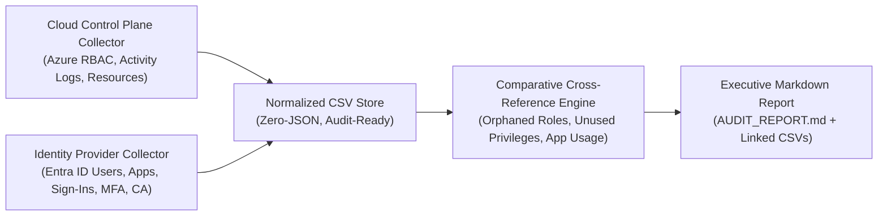

# Multi-Cloud Security & Identity Posture Auditor

A modular, read-only **Cloud Infrastructure Entitlement Management (CIEM)** and **Cloud Security Posture Management (CSPM)** toolkit designed to audit **Identity, Access Governance, and Cloud Resource Security** across multi-cloud environments.

Instead of relying on fragmented portal checks, this toolkit correlates **Identity Provider (IdP) state** with **Cloud Control-Plane Activity Logs** and **Resource Configurations** to surface high-risk blind spots—such as former employees still holding privileged cloud roles, unused standing permissions, stale enterprise applications, and publicly exposed infrastructure.

---

## Architecture & Design



### Why This Architecture?
- **Decoupled Dual-Account Authentication:** In enterprise environments, Cloud subscriptions (e.g., Azure) and Identity Providers (e.g., M365 / Entra ID) are often managed under separate admin accounts. Each collector authenticates independently and writes to a shared output directory; whichever runs second automatically executes the comparative cross-reference.
- **Read-Only & Least-Privilege:** Strictly uses `GET` / Resource Graph queries with `Reader`, `Security Reader`, and `Global Reader` scopes—no state-changing operations.
- **Resilient API Client:** Built-in token caching and exponential backoff on HTTP `429 / 502 / 503 / 504` throttling, plus graceful fallbacks when optional premium licensing (e.g., Entra ID P1/P2) is unavailable.
- **Audit-Ready Output (CSV + Markdown):** Produces clean, tabular CSVs for filtering/remediation alongside an executive `AUDIT_REPORT.md` with summary metrics and direct links to every dataset.

---

## Multi-Cloud Coverage

| Cloud / Identity Provider | Status | Scope Covered |
| :--- | :--- | :--- |
| **Microsoft Azure & Entra ID** | **Implemented** ([`azure/`](./azure)) | RBAC vs. Entra ID (orphaned, disabled, soft-deleted, guest, inactive, and group-inherited roles), 90-day Activity Log usage correlation, Enterprise App & App Registration usage + active user names + secret/cert expiry, MFA registration, Directory Roles, Conditional Access, Key Vault, Storage, NSGs/Public IPs, Databases, App Services, ACR/AKS, Defender for Cloud Secure Score & Diagnostic Logs |
| **Amazon Web Services (AWS)** | **Implemented** ([`aws/`](./aws)) | IAM Users/MFA/Access Keys & unused key detection, Unused/Admin IAM Roles (`RoleLastUsed`) & wildcard trust policies, S3 public access/encryption/versioning, VPC Security Groups (`0.0.0.0/0`) & Elastic IPs, EC2 IMDSv2, EBS/RDS encryption, KMS rotation, CloudTrail & GuardDuty |
| **Google Cloud Platform (GCP)** | **Implemented** ([`gcp/`](./gcp)) | Project IAM bindings (`Owner`/`Editor`, `allUsers`, personal emails, deleted principals), Service Account user-managed keys, Cloud Audit Logs activity correlation, GCS public access & Cloud SQL posture, VPC Firewalls (`0.0.0.0/0`), Compute VM exposure & Cloud Logging Sinks |

---

## Repository Structure

```text
cloud-security-audit/
├── README.md
├── LICENSE
├── .gitignore
├── azure/
│   ├── audit_azure.py        # Part 1: Azure subscriptions, RBAC, Activity Logs & resource posture
│   ├── audit_entra.py        # Part 2: Entra ID users, MFA, CA, apps, sign-ins & group resolution
│   ├── audit_common.py       # Shared REST client, pagination, CSV I/O & report builder
│   └── requirements.txt
├── aws/
│   └── README.md             # Planned AWS module specification
└── gcp/
    └── README.md             # Planned GCP module specification
```

---

## Quick Start (Azure & Entra ID)

### Prerequisites
- **Python 3.10+**
- **Read-Only Permissions:**
  - **Azure:** `Reader` + `Security Reader` at the Tenant Root Group (or target subscriptions)
  - **Entra ID:** `Global Reader` (or `Directory Readers` + `Reports Reader` + `AuditLog.Read.All`)

### Installation & Execution
```powershell
cd azure
pip install -r requirements.txt

# Step 1: Authenticate with your Azure account (audits all enabled subscriptions)
python audit_azure.py --interactive

# Step 2: Authenticate with your M365 / Entra ID account (completes cross-reference & builds AUDIT_REPORT.md)
python audit_entra.py --interactive
```

> **Note:** `--interactive` opens a browser sign-in prompt, so Azure CLI (`az login`) is not required. If you already use `az login` or Service Principal environment variables, omit `--interactive`.

### Generated Output (`./audit_output/`)
- `AUDIT_REPORT.md` — Executive summary, top critical findings, coverage warnings, and links to all CSVs.
- `csv/01_orphaned_and_disabled_rbac.csv` — Former/deleted, disabled, or guest accounts (direct or via Entra groups) holding Azure roles.
- `csv/02_unused_and_privileged_rbac.csv` — All RBAC assignments correlated with 90-day Azure Activity Logs and Entra sign-ins.
- `csv/03_entra_inactive_and_mfa_users.csv` — Disabled, soft-deleted, guest, inactive, and MFA-unregistered users.
- `csv/04_entra_directory_roles.csv` — Members of privileged Entra ID directory roles.
- `csv/05_entra_apps_and_usage.csv` — App Registrations & Enterprise Apps with last-used date, active user names, owners, and expiring secrets/certs.
- `csv/06_conditional_access_policies.csv` — Conditional Access policy inventory.
- `csv/07_keyvault_and_storage_findings.csv` — Key Vault & Storage Account security posture.
- `csv/08_network_exposure_and_nsgs.csv` — Public IPs and risky `0.0.0.0/0` inbound NSG rules.
- `csv/09_compute_db_and_paas_findings.csv` — Databases, App Services, ACR, and AKS posture.
- `csv/10_defender_scores_and_assessments.csv` — Defender for Cloud Secure Score, High/Medium recommendations, and Activity Log export status.

---

## Security & Hygiene
- The included `.gitignore` excludes `audit_output*/`, `*.csv`, and `.env` files so sensitive tenant audit data is never accidentally committed to version control.
- Designed strictly for authorized, read-only security assessments.
