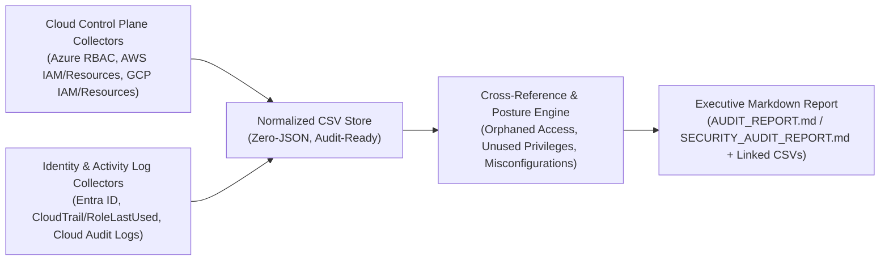

# Multi-Cloud Security & Identity Posture Auditor

A modular, **strictly read-only** **Cloud Infrastructure Entitlement Management (CIEM)** and **Cloud Security Posture Management (CSPM)** toolkit designed to audit **Identity, Access Governance, and Cloud Resource Security** across **Azure, AWS, and GCP**.

Instead of relying on fragmented portal checks, this toolkit correlates **Identity & IAM State** with **Control-Plane Activity Logs** and **Resource Configurations** to surface high-risk blind spots—such as orphaned/disabled accounts still holding cloud roles, unused standing privileges, stale applications/service account keys, and publicly exposed infrastructure.

---

## Architecture & Design



### Key Engineering Principles
- **Read-Only & Least-Privilege:** Strictly uses `GET` / read-only query APIs—no state-changing or destructive operations.
- **Decoupled Dual-Account Support (Azure & Entra ID):** Supports separate credentials for Cloud subscriptions vs. Identity Providers, automatically cross-referencing both into a unified report.
- **Resilient API Clients:** Built-in pagination and exponential backoff on HTTP `429 / 502 / 503 / 504` throttling, plus graceful fallbacks when optional enterprise licensing is unavailable.
- **Zero-JSON, Audit-Ready Output:** Produces clean tabular CSVs for filtering/remediation alongside an executive Markdown report with summary metrics and clickable links to every dataset.

---

## Multi-Cloud Coverage

| Cloud / Identity Provider | Module | Scope Covered |
| :--- | :--- | :--- |
| **Microsoft Azure & Entra ID** | [`azure/`](./azure) | RBAC vs. Entra ID (orphaned, disabled, soft-deleted, guest, inactive, and group-inherited roles), 90-day Activity Log usage correlation, Enterprise App & App Registration usage + active user names + secret/cert expiry, MFA registration, Directory Roles, Conditional Access, Key Vault, Storage, NSGs/Public IPs, Databases, App Services, ACR/AKS, Defender for Cloud Secure Score & Diagnostic Logs |
| **Amazon Web Services (AWS)** | [`aws/`](./aws) | Root MFA, IAM Users/MFA/Access Keys & unused key detection, Unused/Admin IAM Roles (`RoleLastUsed`) & wildcard trust policies, S3 public access/encryption/versioning, VPC Security Groups (`0.0.0.0/0`) & Elastic IPs, EC2 IMDSv2, EBS/RDS encryption, KMS rotation, CloudTrail & GuardDuty |
| **Google Cloud Platform (GCP)** | [`gcp/`](./gcp) | Project IAM bindings (`Owner`/`Editor`, `allUsers`, personal emails, deleted principals), Service Account user-managed keys, Cloud Audit Logs activity correlation, GCS public access & Cloud SQL posture, VPC Firewalls (`0.0.0.0/0`), Compute VM exposure & Cloud Logging Sinks |

---

## Repository Structure

```text
cloud-security-audit/
├── README.md
├── LICENSE
├── .gitignore
├── azure/
│   ├── audit_azure.py          # Part 1: Azure subscriptions, RBAC, Activity Logs & resource posture
│   ├── audit_entra.py          # Part 2: Entra ID users, MFA, CA, apps, sign-ins & group resolution
│   ├── audit_common.py         # Shared REST client, pagination, CSV I/O & comparative report builder
│   └── requirements.txt
├── aws/
│   ├── audit_aws_security.py   # Multi-region AWS security & IAM audit
│   ├── aws_common.py           # Shared boto3 helpers, region discovery & CSV/Markdown utilities
│   ├── requirements.txt
│   └── README.md
└── gcp/
    ├── audit_gcp_security.py   # Multi-project GCP security, IAM & Audit Log correlation
    ├── gcp_common.py           # Shared GCP REST client (ADC), pagination & CSV/Markdown utilities
    ├── requirements.txt
    └── README.md
```

---

## Quick Start

### 1. Microsoft Azure & Entra ID ([`azure/`](./azure))
- **Permissions:** `Reader` + `Security Reader` (Azure) and `Global Reader` (Entra ID)
```powershell
cd azure
pip install -r requirements.txt
python audit_azure.py --interactive
python audit_entra.py --interactive
```

### 2. Amazon Web Services ([`aws/`](./aws))
- **Permissions:** `SecurityAudit` + `ReadOnlyAccess` (or equivalent read-only IAM policy)
```powershell
cd aws
pip install -r requirements.txt
python audit_aws_security.py --profile my-readonly-profile
```

### 3. Google Cloud Platform ([`gcp/`](./gcp))
- **Permissions:** `roles/viewer` + `roles/iam.securityReviewer` + `roles/logging.viewer`
```powershell
cd gcp
pip install -r requirements.txt
gcloud auth application-default login
python audit_gcp_security.py
```

---

## Security & Hygiene
- `.gitignore` excludes `audit_output*/`, `aws_security_output*/`, `gcp_security_output*/`, `*.csv`, and `.env` files so sensitive tenant audit data is never committed to version control.
- Designed strictly for authorized, read-only security assessments.
